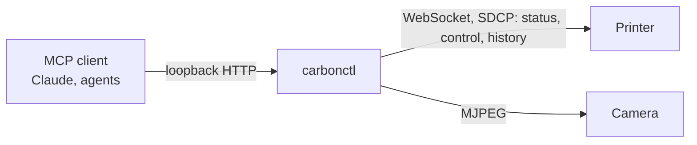

# carbonctl

An MCP server for the Elegoo Centauri Carbon 3D printer (running
[OpenCentauri](https://github.com/OpenCentauri)). It lets an AI assistant check
on a print, look through the camera, read print history, and pause, resume or
stop a print, without being able to do anything else to the printer.



## Tools

| Tool | What it does |
|---|---|
| `carbonctl_get_status` | Current printer state |
| `carbonctl_get_snapshot` | One fresh camera image |
| `carbonctl_get_history` | Recent print history |
| `carbonctl_pause` / `carbonctl_resume` | Pause or resume the active print |
| `carbonctl_prepare_stop` → `carbonctl_confirm_stop` | Two-step stop, approved by a human |

## Safety by design

An assistant that can control real hardware needs hard limits:

- **Allowlist, not denylist.** Only pause, stop and resume (SDCP 129/130/131) can
  change the printer. Every other command is rejected in one place. History is
  read over a separate read-only allowlist (SDCP 320/321).
- **No one-shot stop.** Stopping needs a token tied to the current print.
  Human approval is the MCP client's job (it prompts before pause, resume,
  prepare_stop and confirm_stop); the server enforces the task-bound token, so a
  stale token or a different print fails.
- **Loopback only.** The server refuses to listen anywhere but localhost.
- **One source of truth** for printer state, so the assistant never acts on a stale view.

## Run

```sh
nix run github:kuhree/carbonctl -- \
  --printer-url ws://printer:3030/websocket \
  --camera-url http://printer:3031/video \
  --state ./state.json --snapshot-dir ./snapshots
```

On NixOS, `nixosModules.default` runs it as a sandboxed service that can reach
only the printer and local clients:

```nix
services.carbonctl = {
  enable = true;
  printer = "192.168.1.50";
};
```

## Develop

`nix develop`, then `go test ./...`. `nix flake check` builds the package (which
runs the tests) and a NixOS VM test of the module.

Contributing rules are in [AGENTS.md](AGENTS.md).
